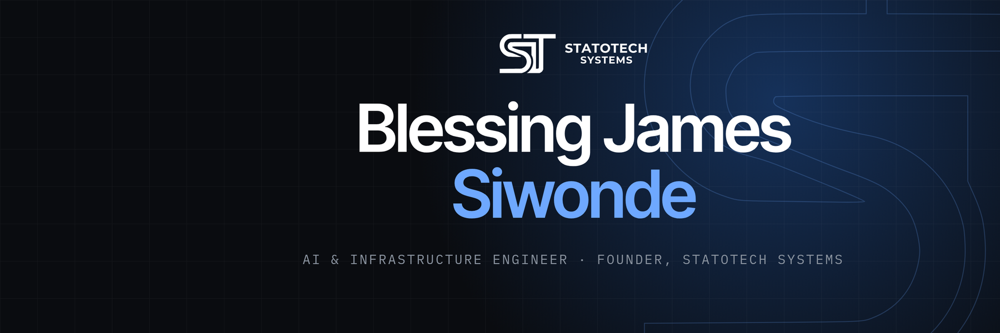

  
  
  
  
  

<samp>01 · ABOUT</samp>

## I build AI systems and the infrastructure they run on.

I'm an **AI & Infrastructure Engineer at Gractor** in Seoul and the founder of
**[Statotech Systems](https://statotec.com)** in Harare. My days go to LLM reasoning over
ontologies, time-series models and the GPU servers underneath them. Through Statotech Systems I build and
run software for businesses in Zimbabwe and across Africa.

<table>
  <tr>
    <td width="50%" valign="top">
      <b>Now</b> 
      Intelligent ontology systems that combine LLM reasoning with AI DB inference, and time-series
      anomaly detection, on GPU servers with open-source model serving.
    </td>
    <td width="50%" valign="top">
      <b>Published</b> 
      First author in <i>IEEE Access</i> on hybrid distributed caching. A Ceph–Alluxio design that cut
      backend disk I/O by <b>35×</b>.
      <a href="https://doi.org/10.1109/ACCESS.2026.3664402">doi:10.1109/ACCESS.2026.3664402</a>
    </td>
  </tr>
  <tr>
    <td width="50%" valign="top">
      <b>Studied</b> 
      M.Sc. Computer Engineering, Ajou University 
      B.Sc. (Hons) Computer Science, Bindura University
    </td>
    <td width="50%" valign="top">
      <b>Speak</b> 
      English · Shona · Korean (TOPIK 4)
    </td>
  </tr>
</table>

<samp>02 · STATOTECH SYSTEMS</samp>

<a href="https://statotec.com">
  <picture>
    <source media="(prefers-color-scheme: dark)" srcset="assets/statotech-white.png">
    
  </picture>
</a>

## Software that runs.

Statotech Systems (Private) Limited builds ready-made products for Zimbabwean businesses and takes on
custom development for everything else. We design for the conditions our customers work in:
intermittent power, two currencies in the same till, and paying by phone. Statotech Systems is a member
of NVIDIA Inception.

<table>
  <tr>
    <td align="center" valign="top" width="25%">
       
      <b><a href="https://shop.statotec.com">Statotech POS</a></b> 
      Point of sale for Zimbabwean shops
    </td>
    <td align="center" valign="top" width="25%">
       
      <b><a href="https://school.statotec.com">ZimSchool</a></b> 
      A school ERP, with fees collected through Paynow
    </td>
    <td align="center" valign="top" width="25%">
       
      <b><a href="https://menuwise.statotec.com">MenuWise</a></b> 
      QR digital menus for restaurants
    </td>
    <td align="center" valign="top" width="25%">
       
      <b><a href="https://zimrate.statotec.com">ZimRate</a></b> 
      Live Zimbabwe exchange rates, sold as an API
    </td>
  </tr>
  <tr>
    <td align="center" valign="top" width="25%">
       
      <b><a href="https://afrirate.statotec.com">AfriRate</a></b> 
      Central-bank rates for 28 African countries, with a free API and an <a href="https://github.com/StaticB1/afrirate-mcp">open-source MCP server</a>
    </td>
    <td align="center" valign="top" width="25%">
       
      <b><a href="https://torashaout.com">ToraShaout</a></b> 
      Personalised video messages from celebrities
    </td>
    <td align="center" valign="top" width="25%">
       
      <b><a href="https://pabasa.statotec.com">Pabasa</a></b> 
      GPS-verified attendance for retail merchandisers
    </td>
    <td align="center" valign="middle" width="25%">
      <a href="https://statotec.com"><b>statotec.com →</b></a> 
      <a href="https://www.instagram.com/statotechsystems/">Instagram</a> · <a href="https://www.facebook.com/profile.php?id=61595491015779">Facebook</a>
    </td>
  </tr>
</table>

<samp>03 · OPEN SOURCE</samp>

## Things I've built in the open

| Project | What it does |
| --- | --- |
| [**claude_ai_usage_widget**](https://github.com/StaticB1/claude_ai_usage_widget) | A system-tray widget for Claude Code plan limits, with local token and cost analytics |
| [**browser-llm-api**](https://github.com/StaticB1/browser-llm-api) | An OpenAI-compatible API over your signed-in ChatGPT and Gemini web sessions: chat, vision and image generation |
| [**androlinux**](https://github.com/StaticB1/androlinux) | Run a full Linux distribution on an Android device's own kernel, with no virtual machine |
| [**afrirate-mcp**](https://github.com/StaticB1/afrirate-mcp) | AfriRate's African exchange rates, inflation and gold prices for AI agents |
| [**claude-code-sounds**](https://github.com/StaticB1/claude-code-sounds) | Audio notifications for Claude Code permission prompts |
| [**taffline-bricks**](https://github.com/StaticB1/taffline-bricks) | Website for a Zimbabwean building-materials supplier |

<samp>04 · TOOLS</samp>

## What I work with

  
  
  
  
  
  
  
  
  
  
  
  
  

**AI and ML:** LLM integration and serving (Claude, Qwen3-32B), RAG, ontologies and knowledge graphs with
AI DB, time-series ML, MCP servers. 
**Systems:** Ceph, Alluxio, FUSE, distributed file systems, cache tiering, HPC benchmarking (FIO), GPU
provisioning.

<samp>05 · BACKGROUND</samp>

## Where I've worked

| Where | Role | When |
| --- | --- | --- |
| **Statotech Systems**, Harare | Founder | 2026– |
| **Gractor**, Seoul | AI & Infrastructure Engineer | 2026– |
| **Ajou University Systems Research Lab** | Graduate Research Engineer: built and benchmarked a 4-node HPC storage testbed; published in *IEEE Access* | 2024–2026 |
| **Ethics Consulting Zimbabwe** | Software Developer: five production systems for banking clients, including a Treasury Dealing System | 2019–2022 |

<samp>06 · ON GITHUB</samp>

  
  

---

  <samp>HARARE, ZIMBABWE · SEOUL, KOREA · <a href="https://statotec.com">STATOTEC.COM</a></samp> 
  Me: bsiwonde@gmail.com · Statotech Systems: contact@statotec.com

